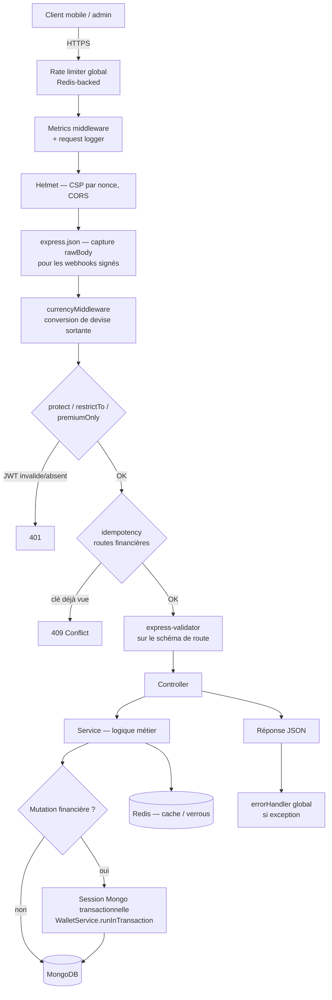
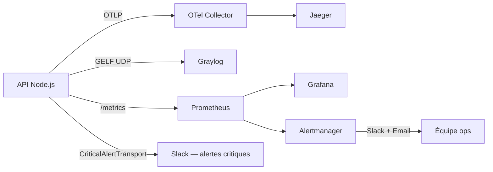
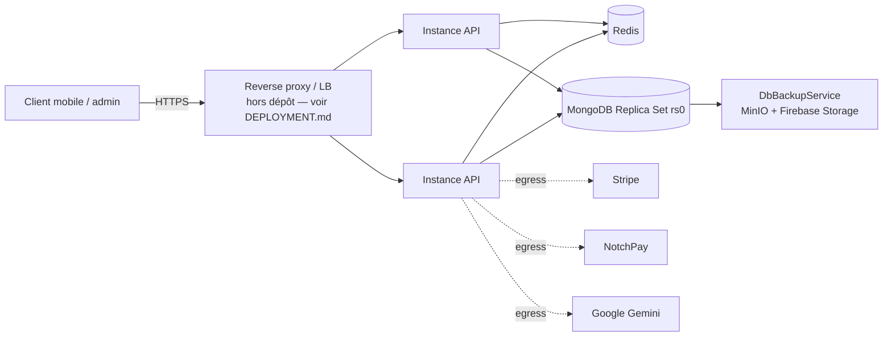

# Architecture Kauri

Ce document décrit l'architecture technique du backend Kauri : comment les composants s'assemblent, comment une requête traverse le système, et pourquoi certains choix structurants ont été faits — en particulier ceux qui protègent l'intégrité de l'argent réel manipulé par l'application.

Pour la posture sécurité (contrôles, politiques), voir [SECURITY.md](SECURITY.md). Pour les procédures de mise en production, voir [DEPLOYMENT.md](DEPLOYMENT.md).

---

## 1. Vue d'ensemble de l'écosystème

Kauri est composé de trois dépôts distincts qui communiquent exclusivement via l'API HTTP décrite ici :

| Dépôt | Rôle | Stack |
| :-- | :-- | :-- |
| **djangui-api** (ce dépôt) | Backend — logique métier, persistance, intégrations | Node.js 20 / TypeScript / Express |
| **djangui-admin** | Dashboard d'administration | React / TypeScript |
| **djangui-mobile** | Application cliente finale | Flutter / Dart |

Le backend est la seule source de vérité pour tout calcul financier — aucun solde, taux de change ou prix d'abonnement n'est jamais fait confiance venant du client (principe *zero-trust client*, voir SECURITY.md § 1).

---

## 2. Anatomie d'une requête



Chaque étape de cette chaîne existe pour une raison précise :

- **Rate limiter en premier** — bloque l'abus avant que la requête ne coûte quoi que ce soit en CPU applicatif.
- **`rawBody` capturé avant parsing JSON** — les signatures de webhook Stripe/NotchPay sont vérifiées sur les octets exacts envoyés par le fournisseur ; une re-sérialisation de `req.body` ne matcherait pas forcément bit à bit (ordre des clés, formatage des nombres) et rejetterait de vrais webhooks.
- **Idempotence avant le contrôleur** — une clé `Idempotency-Key` déjà vue court-circuite la requête avant qu'elle ne touche la logique métier, via un `SET NX` Redis atomique (pas de fenêtre de course lecture-puis-écriture).
- **Session Mongo transactionnelle pour toute mutation financière** — dépôt, retrait, cotisation tontine, dépôt de défi : soit toutes les écritures liées (solde utilisateur, document `Transaction`, mise à jour de l'entité métier) sont validées ensemble, soit aucune ne l'est.

---

## 3. Organisation du code (`src/`)

```
src/
├── app.ts              # Assemblage Express : middlewares, routes, error handler
├── server.ts            # Point d'entrée process — validation d'env, bootstrap, arrêt propre
├── config/               # Connexions externes (Mongo, Redis, Stripe, NotchPay, Firebase, tracing)
├── models/                # Schémas Mongoose — la forme des données au repos
├── middleware/             # auth, idempotency, requestLogger, errorHandler, currencyMiddleware...
├── controllers/             # Traduction HTTP ↔ appel de service, pas de logique métier
├── services/                # Toute la logique métier — wallet, transaction, fraud, KYC, tontine...
│   └── ai/                    # Wrapper GeminiService (coût/métriques centralisés) + OCR, coach, avatar
├── routes/                 # Déclaration des routes + rate limiters dédiés par domaine
├── validators/               # Schémas express-validator par route
├── utils/                    # vaultCrypto, distributedLock, rateLimitStore, logger, cryptoUtils...
└── i18n/                    # Traductions des notifications (clé → texte par langue)
```

**Règle de dépendance** : les controllers appellent des services, les services appellent des models — jamais l'inverse, et un controller n'accède jamais directement à un model Mongoose pour une opération qui modifie de l'argent (toujours via `WalletService`/`TransactionService`).

---

## 4. Les garde-fous financiers — le cœur du système

Ce sont les mécanismes qui distinguent une API qui *affiche* des chiffres d'une API à qui on peut confier de l'argent réel.

### 4.1 Atomicité — `WalletService.runInTransaction`
Toute opération qui touche `walletBalance` s'exécute dans une session MongoDB (`startSession().withTransaction()`). Si une étape échoue (ex. le document `Transaction` ne s'enregistre pas), la mise à jour du solde est annulée avec — jamais d'état intermédiaire où l'argent a "disparu" entre deux collections.

### 4.2 Idempotence — `middleware/idempotency.ts`
Les routes qui mutent de l'argent acceptent un header `Idempotency-Key` (ou un champ `idempotencyKey` en fallback). La clé est réclamée par `SET NX` Redis — atomique, donc deux requêtes quasi-simultanées avec la même clé ne peuvent jamais toutes les deux passer. Si la requête finit en erreur, la clé est libérée pour permettre un vrai retry.

### 4.3 Verrous distribués — `utils/distributedLock.ts`
Pour les opérations qui touchent une ressource partagée hors transaction Mongo (ex. traitement d'un tour de tontine), un verrou Redis (script Lua atomique pour l'acquisition/libération) empêche deux workers de traiter la même ressource en parallèle.

### 4.4 Détection de fraude — `FraudService`
Score heuristique (0–100) évalué à chaque dépôt/retrait : vélocité (>5 tx/10 min), retraits rapprochés, montant atypique (>5x la moyenne historique), dépôts rapprochés (card-testing). Score ≥70 → blocage automatique + alerte Slack immédiate. Chaque règle déclenchée est aussi exposée en métrique Prometheus (`fraud_alerts_total`, `suspicious_activity_total`).

### 4.5 Audit trail immuable — `AuditService`
Deux modes d'écriture, choisis délibérément selon la criticité :
- **`record()`** — fire-and-forget, pour les événements à faible enjeu (export de rapport, mise à jour de paramètres).
- **`recordSync()`** — attendu (`await`) avant de répondre au client, pour tout ce qui déplace de l'argent ou élève des privilèges (crédit manuel de wallet par un admin, changement de rôle, approbation de relance de paiement). Si l'écriture d'audit échouait silencieusement sur une action fire-and-forget, l'action financière aurait déjà eu lieu sans trace — inacceptable pour ces catégories.

Rétention légale : 5 ans par défaut (`AUDIT_LOG_RETENTION_DAYS`), aligné sur les obligations AML/KYC typiques.

### 4.6 Webhooks de paiement
Stripe et NotchPay signent leurs payloads ; la vérification se fait sur les octets bruts exacts (voir § 2). Un retrait échoué déclenche un remboursement automatique **dans une transition d'état atomique** (`findOneAndUpdate` avec garde `status: { $ne: 'failed' }`) — deux livraisons dupliquées du même webhook ne peuvent pas rembourser deux fois.

---

## 5. Couche cache & coordination — Redis

Redis n'est pas qu'un cache dans cette architecture, il est sur le chemin critique de plusieurs garanties :

| Usage | Mécanisme |
| :-- | :-- |
| Rate limiting (global + par route sensible) | `rate-limit-redis`, store partagé via `utils/rateLimitStore.ts` |
| Idempotence des paiements | `SET NX` avec TTL 24h |
| Verrous distribués | Script Lua atomique (acquire/release) |
| Liste noire JWT | Token blacklisté au logout, TTL = expiration résiduelle du token |
| Verrouillage de compte (brute force) | Compteur d'échecs de connexion par email |
| Quota de génération d'avatar IA | Compteur journalier par utilisateur |

Redis est donc un composant **stateful critique**, pas une optimisation — sa perte de données (sans persistance AOF) invaliderait sessions et verrous en cours, d'où `--appendonly yes` dans la configuration Docker.

---

## 6. Observabilité



- **Prometheus / Grafana** — 99 métriques métier et techniques (`MonitoringService`), couvrant HTTP, DB, transactions, wallets, auth, KYC, fraude, webhooks, jobs, IA. Le dashboard `grafana/dashboards/kauri-api.json` (121 panneaux) est la référence — voir sa section dédiée dans DEPLOYMENT.md.
- **Winston + Graylog** — logs structurés, rotation quotidienne locale + centralisation optionnelle GELF. `CriticalAlertTransport` route les erreurs de niveau critique vers Slack, avec repli email si Slack échoue, et masquage automatique des secrets dans le message.
- **OpenTelemetry + Jaeger** — traçage distribué des requêtes, activable via `ENABLE_TRACING`.

Le détail des 99 métriques et leur statut (câblées / définies mais non utilisées) est documenté dans le dashboard lui-même — chaque panneau reste visible même sans données, pour rendre visible ce qui est instrumenté vs seulement défini.

---

## 7. Topologie de déploiement



Points clés :
- **API stateless** — aucune session en mémoire locale (tout est en Redis), donc scaling horizontal sans sticky sessions.
- **MongoDB en replica set (`rs0`)** dès le docker-compose fourni, avec authentification par keyfile — condition requise par Mongoose pour les transactions ACID utilisées en § 4.1.
- **MongoDB et Redis ne sont jamais exposés sur l'hôte** — accessibles uniquement depuis le réseau Docker interne (`expose`, pas `ports`).
- **TLS n'est pas géré dans ce dépôt** — aucun reverse proxy (nginx/traefik/caddy) n'est fourni ; c'est une responsabilité d'infrastructure à ajouter en amont (voir DEPLOYMENT.md § Ce qui n'est pas dans ce dépôt).

---

## 8. Décisions d'architecture notables

| Décision | Pourquoi |
| :-- | :-- |
| **`execFile` plutôt que `exec`** pour toute opération shell (sauvegarde/restauration DB) | `execFile` passe les arguments directement au process, jamais interpolés dans un shell — élimine une classe entière d'injection de commande sur un nom de fichier venant d'une requête admin. |
| **Whitelist d'opérateurs Mongo (`$gte,$gt,$lte,$lt,$ne,$in`)** sur les filtres admin construits depuis `req.query` | Empêche l'injection de `$where`/`$expr` via une clé de query-string arbitraire, tout en gardant le filtrage avancé légitime. |
| **`AuditService.record()` vs `recordSync()`** (§ 4.5) | Un choix explicite par type d'événement plutôt qu'un seul mode global — équilibre durabilité garantie sur le critique et latence minimale sur le reste. |
| **`GeminiService` comme point de passage unique pour tous les appels IA** | Centralise le suivi de coût (`AIUsage`) et les métriques Prometheus IA — toute fonctionnalité IA qui le contournerait (ex. génération d'image, voir historique du projet) perd cette visibilité, ce qui a été traité comme une régression à corriger, pas une exception acceptable. |
| **Budget/Objectifs comme suggestion, jamais de virement automatique** | Le surplus d'un budget n'est qu'un chiffre de suivi (`alloué - dépensé`), pas de l'argent réellement mis de côté. Le faire flotter automatiquement vers un objectif d'épargne reviendrait à débiter le wallet sans action explicite de l'utilisateur — le système notifie et suggère, l'utilisateur confirme via le mécanisme de contribution existant. |

---

## 9. Pour aller plus loin

- **Sécurité** — [SECURITY.md](SECURITY.md)
- **Déploiement & variables d'environnement** — [DEPLOYMENT.md](DEPLOYMENT.md)
- **Procédures opérationnelles (rotation de secrets, restauration, webhooks)** — [RUNBOOK.md](RUNBOOK.md)
- **Documentation API interactive** — `/api-docs` (Swagger, protégé par Basic Auth)
