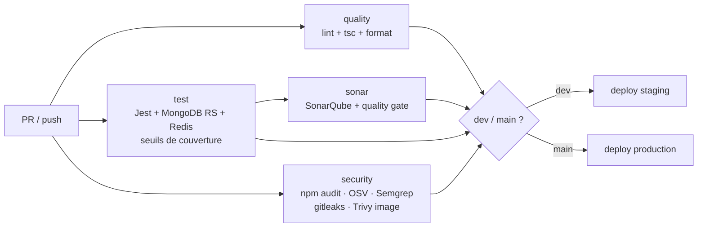

# 🏦 Kauri — Backend Fintech (API REST)

Kauri est une API REST pour la gestion de finances personnelles assistée par IA : portefeuille, tontines digitales, budgets partagés, objectifs d'épargne, défis d'épargne gamifiés, KYC automatisé, et un hub revendeur. Le backend est la seule source de vérité financière — aucun calcul de solde, de taux de change ou de prix n'est jamais confié au client mobile ou admin.

**Documentation complète :**
- [ARCHITECTURE.md](ARCHITECTURE.md) — comment le système est construit et pourquoi
- [SECURITY.md](SECURITY.md) — contrôles de sécurité, conformité, résultats d'audit
- [DEPLOYMENT.md](DEPLOYMENT.md) — déploiement, variables d'environnement, CI/CD
- [RUNBOOK.md](RUNBOOK.md) — procédures opérationnelles (rotation de secrets, sauvegardes, incidents)
- [CONTRIBUTING.md](CONTRIBUTING.md) — standards de code, tests, qualité et procédure de contribution
- [CHANGELOG.md](CHANGELOG.md) — historique des changements
- `/api-docs` — documentation Swagger interactive (protégée par Basic Auth)

---

## Ce que fait Kauri

- **Portefeuille & transactions** — dépôt, retrait, transfert, avec détection de fraude heuristique en temps réel et remboursement automatique sur échec de transfert opérateur.
- **Tontines digitales** — cotisations tournantes avec suivi des tours, pénalités de retard configurables, et code d'invitation.
- **Budgets** — enveloppes par catégorie, alertes de dépassement, vue "reste à vivre" consolidée, historique visuel des dépenses, **budgets partagés** multi-participants (même modèle que les tontines), et lien optionnel vers un objectif d'épargne (suggestion, jamais de virement automatique).
- **Objectifs d'épargne** — contribution manuelle ou automatisée, calcul de progression.
- **Défis d'épargne** — challenges hebdomadaires avec dépôt réel, système de report/skip limité, résolution automatique à l'expiration.
- **KYC automatisé** — soumission de documents, analyse par IA (Gemini Vision) avec rapport de confiance, validation manuelle finale par un admin.
- **Coach IA & OCR** — analyse conversationnelle des habitudes financières, scan de reçus par vision, génération d'avatar de profil par IA.
- **Hub Revendeur** — gestion de slots, facturation d'abonnement automatisée, notifications programmées.
- **Paiements** — Stripe (cartes) et NotchPay (Mobile Money), webhooks vérifiés par signature, **plus** un polling de secours (cron chaque minute, idempotent) qui finalise les paiements même si un webhook n'arrive jamais.
- **Gamification** — points d'expérience, niveaux, badges liés aux défis complétés.

---

## Architecture & Stack Technique

| Composant | Technologie | Rôle |
| :-- | :-- | :-- |
| **Backend** | Node.js 22 LTS / TypeScript / Express | Logique métier & API REST |
| **Base de données** | MongoDB 7 (replica set) | Stockage persistant, transactions ACID |
| **Cache & coordination** | Redis 7 | Rate limiting, idempotence, verrous distribués, liste noire JWT |
| **Fichiers** | MinIO (S3-compatible) | Reçus, documents KYC, avatars, sauvegardes |
| **IA & Vision** | Google Gemini | Coach financier, OCR, analyse KYC, génération d'avatar |
| **Paiements** | Stripe / NotchPay | Cartes bancaires / Mobile Money |
| **Observabilité** | Prometheus / Grafana | 99 métriques métier et techniques, dashboard de 121 panneaux |
| **Logs** | Winston / Graylog | Logs structurés, rotation, alertes critiques Slack+email |
| **Traçage** | OpenTelemetry / Jaeger | Traçage distribué des requêtes |

### Écosystème Kauri

| Dépôt | Rôle | Stack | Déploiement |
| :-- | :-- | :-- | :-- |
| **djangui-api** (ce dépôt) | API REST | Node 22 / TS / Express | GitHub Actions → GHCR → VPS (`dev` = staging, `main` = prod) |
| **djangui-admin** | Dashboard d'administration | React / Vite / TS | GitHub Actions → GHCR → VPS |
| **djangui-mobile** | Application Android / iOS | Flutter 3.47.6 | staging : GitHub ; production : Codemagic |
| **kauri-website** | Site vitrine & pages légales | HTML statique / nginx | GitHub Actions → VPS (push sur `main` = prod) |

Le détail des décisions d'architecture (garde-fous financiers, anatomie d'une requête, topologie de déploiement) est dans [ARCHITECTURE.md](ARCHITECTURE.md).

---

## Démarrage rapide

Prérequis : **Node.js 22 LTS ou 24 LTS** (Node 20 est en fin de vie depuis avril 2026), Docker 24+.

```bash
cp .env.example .env
# Renseigner au minimum : JWT_ACCESS_SECRET, JWT_REFRESH_SECRET,
# VAULT_ENCRYPTION_KEY, MONGODB_URI, GEMINI_API_KEY
docker compose -f docker-compose.dev.yml up --build
```

Trois modes Docker sont disponibles (développement léger, staging avec observabilité complète, production) — détail complet des prérequis, variables d'environnement (applicatives **et** infrastructure), pipeline CI/CD et bootstrap du premier compte admin dans [DEPLOYMENT.md](DEPLOYMENT.md).

Sans Docker, en local :
```bash
npm install
npm run dev      # nodemon sur src/server.ts
```

Scripts disponibles :
| Commande | Rôle |
| :-- | :-- |
| `npm run dev` | Serveur de développement avec rechargement à chaud |
| `npm run build` | Compilation TypeScript vers `dist/` |
| `npm start` | Lance le build compilé |
| `npm test` | Suite de tests (Jest) — nécessite MongoDB en replica set et Redis |
| `npm run test:ci` | Tests + couverture avec seuils (utilisé par la CI) |
| `npm run lint` | Vérification ESLint (échoue en cas d'erreur) |
| `npm run format` | Réécrit les fichiers avec Prettier |
| `npm run seed:admin` | Crée ou réinitialise le premier compte administrateur |
| `npm run seed` | Initialise les feature flags par défaut |

---

## Qualité, tests et CI/CD

Chaque Pull Request et chaque push sur `dev`/`main` exécute `.github/workflows/ci.yml` :



- **Tests** : 92 tests Jest (unitaires + intégration sécurité/paiements), seuils de couverture dans `jest.config.js`.
- **Sécurité** : Semgrep (0 erreur tolérée), gitleaks (`.gitleaks.toml`), Trivy (0 HIGH/CRITICAL sur l'image), OSV-Scanner.
- **SonarQube** : instance auto-hébergée (`sonar-project.properties`), quality gate bloquante.
- **Dépendances** : Dependabot hebdomadaire sur `dev` (`.github/dependabot.yml`).

---

## Observabilité

Le dashboard Grafana **"Kauri API — Production Dashboard"** (`grafana/dashboards/kauri-api.json`, chargé automatiquement au démarrage) couvre l'intégralité des 99 métriques Prometheus exposées, organisées en 16 sections : Overview/SLOs, HTTP, Runtime Node.js, Base de données, Transactions financières, Wallets & Économie, Utilisateurs & Authentification, KYC, Providers de paiement & Webhooks, Notifications, Sécurité & Compliance, Jobs, IA & Cache, Tontines/Objectifs/Défis, Investissement, Services externes.

Accès (une fois la stack staging/production démarrée). Ces interfaces sont publiées **uniquement sur `127.0.0.1`** de l'hôte (variable `INTERNAL_BIND_ADDR`) : on y accède via le reverse proxy ou un tunnel SSH (`ssh -L 3001:127.0.0.1:3001 user@serveur`), jamais directement depuis Internet.
- **Grafana** — `http://127.0.0.1:3001`
- **Prometheus** — `http://127.0.0.1:9090`
- **Jaeger** — `http://127.0.0.1:16686` (aucune authentification native — ne jamais l'exposer)
- **Graylog** — `http://127.0.0.1:9000`

Procédure de mise en route complète, y compris le piège des webhooks d'alerte laissés en placeholder, dans [DEPLOYMENT.md](DEPLOYMENT.md) § Monitoring.

---

## Sécurité

Résumé des garanties principales — détail complet, y compris les résultats du dernier audit applicatif, dans [SECURITY.md](SECURITY.md) :

- **Idempotence** — header `Idempotency-Key` sur toutes les opérations financières, réclamé atomiquement (Redis `SET NX`).
- **Atomicité** — toute mutation de solde s'exécute dans une transaction MongoDB.
- **MFA (TOTP)** — sur les comptes admin/support.
- **Sessions** — révoquées sur tous les appareils après une réinitialisation de mot de passe ; changement de mot de passe = déconnexion des autres appareils.
- **Cookies admin** — httpOnly + `SameSite=Lax` ; avec `X-Client-Type: web` aucun token n'est renvoyé dans le JSON ; contrôle d'origine (anti-CSRF) sur toute requête mutante authentifiée par cookie.
- **Limitation de débit** — auth 30/15 min, flux e-mail 10/15 min, verrouillage de compte après 10 échecs.
- **Tokens** — access 15 min / refresh 7 jours, identifiant `jti` unique, révocation de session.
- **Conteneur** — image Node 22 non-root, HEALTHCHECK, ports publiés sur `127.0.0.1` uniquement.
- **Chiffrement au repos** — AES-256-GCM authentifié pour les données sensibles.
- **Détection de fraude** — score heuristique en temps réel, blocage automatique au-delà du seuil.
- **Audit trail immuable** — actions à fort impact journalées de façon synchrone, rétention 5 ans.

---

## Contribution

Voir [CONTRIBUTING.md](CONTRIBUTING.md). Les Pull Requests sont les bienvenues — pour un changement majeur, ouvrez d'abord une issue pour en discuter.

---

**Auteur** : Boris Gauty
**Licence** : [MIT](LICENSE)
